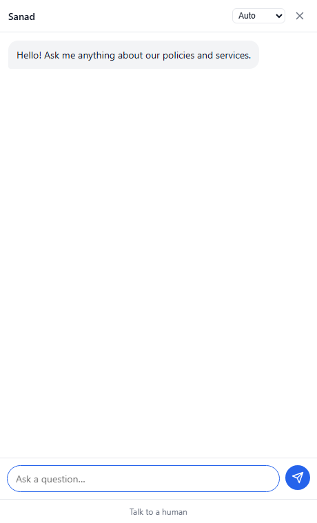
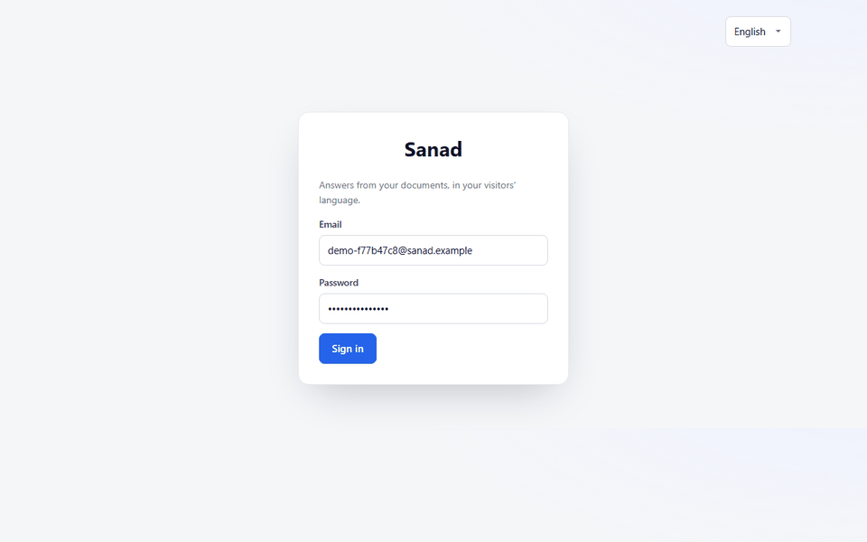
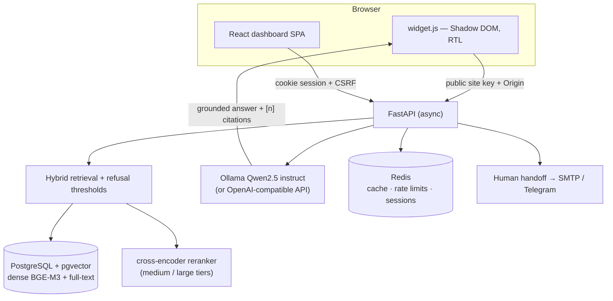

# Sanad (سند)

[](https://github.com/0xaouissi/sanad/actions/workflows/ci.yml)
[](LICENSE)

**A self-hosted support chatbot that answers only from your documents — in
Arabic, French and English.** Drop one script tag on any website; visitors ask
about your policies and services and get grounded answers with citations, in
their own language, with proper RTL. When the documents don't cover a
question, Sanad says so and offers a human handoff instead of guessing.

Local-first by design: Ollama (Qwen 2.5) + BGE-M3 embeddings on your own
hardware, PostgreSQL + pgvector, Redis. No data leaves your server. MIT.

## Demo

| Widget — trilingual answers, citations, RTL, handoff offer | Dashboard — documents, evaluation, settings |
|-----------------------------------------------------------|----------------------------------------------|
|  |  |

Run it yourself or re-record the clips: [docs/demo.md](docs/demo.md).
The demo password is public — change it before any real use.

## Features

- **One script tag** — vanilla-JS widget in a Shadow DOM; no build step, no
  dependencies, host CSS can't break it. Public site key + domain allowlist.
- **Trilingual** — Modern Standard Arabic, French, English; language detected
  per question, answers stay in it, full RTL for Arabic.
- **Grounded only** — answers come from your uploaded documents with inline
  `[n]` citations (filename, page, heading). Outside knowledge is refused.
- **Two refusal kinds** — off-topic gets a polite "company questions only"
  reply; company-related-but-uncovered gets "couldn't find this" **plus an
  inline "Talk to a human"** button prefilled with the question (never
  auto-submitted).
- **Human handoff** — visitor requests delivered to support email (SMTP)
  and/or Telegram, with per-channel status in the dashboard.
- **Local models, hardware tiers** — `small` / `medium` / `large` pick model,
  context and reranker to fit your machine; optional OpenAI-compatible API.
- **Hybrid retrieval** — dense BGE-M3 + PostgreSQL full-text, rank-fused, with
  an optional cross-encoder reranker on bigger tiers.
- **Admin dashboard** — documents, website crawler, failed questions, ratings,
  handoffs, golden evaluation, settings, owner/viewer roles, privacy toggle,
  export & deletion; English/French/Arabic RTL interface.
- **SSRF-safe crawler** — turn your policy pages into documents and keep them
  fresh on a schedule; IP-pinned, per-hop re-validated, robots-aware.
- **Hardened** — per-IP/site rate limits, daily caps, bot check, Redis answer
  cache with in-memory fallback, prompt-injection defense, scrypt passwords,
  httpOnly cookie sessions + CSRF, hashed API keys, Alembic migrations,
  Prometheus metrics.

## Quick start

```bash
docker compose up -d          # API :8000, PostgreSQL+pgvector, Redis, Ollama
curl http://localhost:8000/health
```

First run pulls the tier model (~2 GB for `small`). With an NVIDIA GPU:
`docker compose -f docker-compose.yml -f deployment/docker-compose.gpu.yml up -d`.

Create a company, upload a policy, embed the widget:

```bash
curl -X POST http://localhost:8000/api/v1/companies \
  -H "X-Admin-Key: $ADMIN_API_KEY" -H "Content-Type: application/json" \
  -d '{"name": "Acme", "owner_email": "you@acme.com", "owner_password": "a-long-password"}'
curl -X POST http://localhost:8000/api/v1/documents \
  -H "X-API-Key: $API_KEY" -F "file=@policy.pdf"
```

```html
<script src="http://localhost:8000/widget.js" data-site-key="pk-…" defer></script>
```

Then sign in at `/dashboard/`. Native (no-Docker) setup, every setting and the
full API walkthrough: [docs/development.md](docs/development.md) and
[.env.example](.env.example). Deploy to a real server:
[deployment/README.md](deployment/README.md).

## Architecture



## Evaluation

Deterministic scoring — the model never judges itself. A 42-question golden
set (14 per language) plus a 30-question **held-out** set of unseen phrasings,
run through the real retrieval + prompt + model path.

| Language | Questions | Passed | Model | Tier | Date |
|----------|-----------|--------|-------|------|------|
| English  | 14 | 14 | `qwen2.5:3b-instruct-q4_K_M` | small | 2026-11-17 |
| French   | 14 | 14 | `qwen2.5:3b-instruct-q4_K_M` | small | 2026-11-17 |
| Arabic   | 14 | 13 | `qwen2.5:3b-instruct-q4_K_M` | small | 2026-11-17 |

**Golden: 41 / 42.** Held-out (unseen): **27 / 30**. Embeddings `BAAI/bge-m3`
(CPU), reranker off (small-tier default). Every miss is listed with its failed
checks in [docs/evaluation.md](docs/evaluation.md), which also explains how to
re-tune the refusal thresholds on your own documents.

**Honest note:** this is a sanity check over three short demo policies, not a
benchmark. It proves the pipeline cites, refuses and offers the handoff
correctly on known facts; it says nothing about your corpus. Re-run it on your
documents after uploading them.

## Limitations

- **Small tier is the default.** The 3B model has weaker Arabic grounding and
  cross-language answers; the reported misses are exactly this. Medium/large
  tiers and the reranker reduce them.
- **Default model license.** The small-tier 3B is under the Qwen Research
  License (non-commercial only). For commercial use choose medium/large
  (Apache-2.0) or your own licensed API — see [docs/models.md](docs/models.md).
- **Calibration corpus.** The refusal thresholds were tuned on the same demo
  policies the golden set targets — an upper bound, not a generalization
  estimate. Re-tune on your own documents ([guide](docs/evaluation.md#re-tuning-the-thresholds-on-your-own-documents)).
- **The public site key is not a secret.** It identifies the company and stops
  other *websites* embedding it; a determined script can still call the API
  with a copied key. Real abuse backstops are the server-side rate limits,
  daily caps and bot check (which deters trivial bots, not attackers).
- **OCR is optional and external.** Scanned PDFs/images need Tesseract
  installed; quality depends on it.
- **Single-node.** One API + one PostgreSQL + one Redis; no built-in HA or
  horizontal scaling.
- **Handoff needs operator setup.** SMTP/Telegram credentials live in server
  env vars; without them the form explains what to configure.

## Documentation

| Topic | Guide |
|-------|-------|
| Documents, ingestion, search | [docs/documents.md](docs/documents.md) |
| Grounded chat & refusals | [docs/chat.md](docs/chat.md) |
| Embeddable widget | [docs/widget.md](docs/widget.md) |
| Protection, cache, metrics | [docs/protection.md](docs/protection.md) |
| Admin dashboard | [docs/dashboard.md](docs/dashboard.md) |
| Evaluation & re-tuning | [docs/evaluation.md](docs/evaluation.md) |
| Website crawler | [docs/crawling.md](docs/crawling.md) |
| Human handoff | [docs/handoff.md](docs/handoff.md) |
| Hardware tiers | [docs/hardware-tiers.md](docs/hardware-tiers.md) |
| Model licenses | [docs/models.md](docs/models.md) |
| Development & tests | [docs/development.md](docs/development.md) |
| Demo kit | [docs/demo.md](docs/demo.md) |
| Deployment | [deployment/README.md](deployment/README.md) |
| Roadmap / build history | [docs/roadmap.md](docs/roadmap.md) |

## Tests

```bash
make lint             # ruff
make test-unit        # offline unit tests (mocked providers)
make test-integration # real PostgreSQL + pgvector
make test-e2e         # live Ollama + BGE-M3, ar/fr/en
```

No `make`? Run `python -m pytest` from `backend/` (`-m integration`, `-m e2e`).
Real-browser (Playwright) widget + dashboard tests and the full matrix:
[docs/development.md](docs/development.md).

## Contributing & security

See [CONTRIBUTING.md](CONTRIBUTING.md) and [SECURITY.md](SECURITY.md).
The full git history is scanned with gitleaks; no secrets are committed.

## License

[MIT](LICENSE)