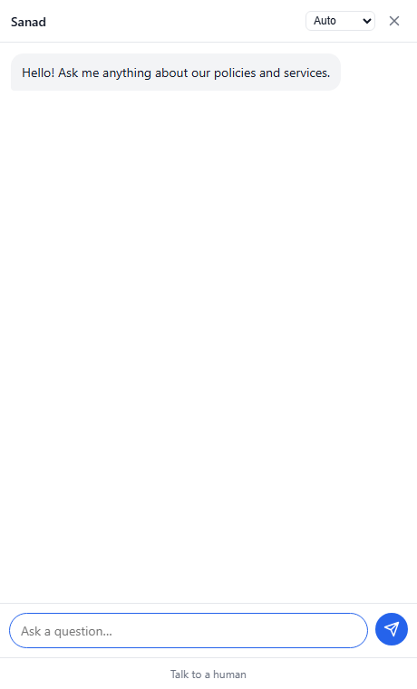
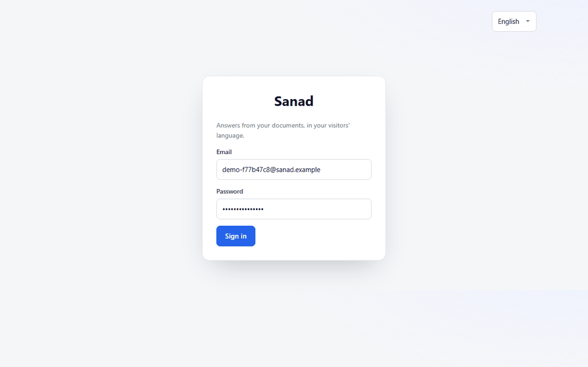

# Demo kit

Two recorded GIFs show the whole product without installing anything:

| Widget (mobile viewport) | Dashboard |
|--------------------------|-----------|
|  |  |

The widget clip asks the same refund question in English, French and Arabic
against the sample documents: streamed answers, citation chips, a thumbs-up,
and the full RTL layout once Arabic is detected. The dashboard clip logs in
and walks the Documents, Evaluation, Handoffs and Settings tabs, then switches
the interface to Arabic (RTL).

To run the demo yourself — or re-record the GIFs — follow the steps below.
Everything stays on your machine; nothing is hosted.

## Prerequisites

The same live stack as the E2E tests (see [development.md](development.md)):

- PostgreSQL with pgvector and the `sanad` database,
- Ollama running with the small-tier model (`ollama pull qwen2.5:3b-instruct-q4_K_M`),
- BGE-M3 weights available (set `HF_HOME` to a folder on a disk with space),
- the backend running: `cd backend && .venv/Scripts/python.exe -m uvicorn app.main:app`
  (Linux/macOS: `.venv/bin/python -m uvicorn app.main:app`).

## 1. Seed the demo company

```bash
cd backend
HF_HOME=/path/to/hf-cache .venv/Scripts/python.exe -m app.eval.seed --password "demo-password-1"
```

Creates the company **Sanad Demo**, uploads the three sample policies from
[`samples/`](../samples) (English, French, Arabic) and ingests them with the
real embedding model. It prints:

- the dashboard login: `demo@sanad.example` with the password you chose,
- the secret `sk-…` API key (**shown once** — copy it),
- the public `pk-…` site key for the widget snippet.

Re-running with the same email fails with a clear message instead of creating
duplicates; use `--email` to seed another company.

## 2. Allow localhost and embed the widget

The seed does not set allowed domains. In the dashboard
(**Settings → Allowed domains**) add `localhost`, or with the secret key:

```bash
curl -X PUT http://127.0.0.1:8000/api/v1/companies/domains \
  -H "X-API-Key: sk-…" -H "Content-Type: application/json" \
  -d '{"domains": ["localhost"]}'
```

Save this as `demo.html` anywhere, replacing `pk-…` with your site key:

```html
<!doctype html>
<html lang="en">
<head><meta charset="utf-8"><title>Sanad demo</title></head>
<body>
  <h1>Acme — demo page</h1>
  <script src="http://127.0.0.1:8000/widget.js" data-site-key="pk-…" defer></script>
</body>
</html>
```

Serve it (the widget checks the page origin, so `file://` will not work):

```bash
python -m http.server 8080
```

Open <http://localhost:8080/demo.html> and click the chat button.

## 3. What to try

**Widget**

- Ask in three languages, same fact:
  - `How many days do I have to request a refund?`
  - `Combien de jours ai-je pour demander un remboursement ?`
  - `كم يوما لدي لطلب استرجاع المبلغ؟`
  Each answer comes back in the question's language with citation chips;
  click a chip to see filename, page and heading.
- Ask something the documents do not cover (`Who won the 2022 World Cup?`) —
  the bot refuses instead of guessing, in the same language.
- Thumbs up/down under an answer; the rating appears in the dashboard.
- The header dropdown forces `ar` / `fr` / `en`; Arabic flips the panel to RTL.
- Narrow the window below 480 px: the panel becomes full-screen mobile layout.
- **Talk to a human** opens the handoff form. With no SMTP/Telegram configured
  it explains what to set; configure `SMTP_*` in `backend/.env` (see
  [handoff.md](handoff.md)) and the request lands in the dashboard Handoffs tab
  and in your support inbox.

**Dashboard** (<http://127.0.0.1:8000/dashboard/>)

- **Documents** — upload your own PDF/DOCX/TXT/MD, watch the status badge,
  reindex or delete (owner only, behind a confirm dialog).
- **Evaluation** — run the 42-question golden set (14 per language) against
  the demo documents; per-language and per-category scores, deterministic
  fact/citation/refusal/handoff checks.
- **Website** — add a URL to crawl into documents (dev-only
  `CRAWL_ALLOW_PRIVATE=true` lets you crawl a local fixture site).
- **Failed questions / Ratings / Handoffs** — what visitors asked, rated and
  requested.
- **Settings** — widget snippet with copy button, allowed domains, the
  conversation-storage privacy toggle, key rotation, JSON export,
  delete-all-conversations, handoff destinations, and adding read-only viewers.
- The language picker switches the whole interface to French or Arabic (RTL).

## 4. Re-record the GIFs

[`scripts/record_demo.py`](../scripts/record_demo.py) drives real Chromium
through the whole flow above and assembles both GIFs with Pillow. It starts
its **own** API server on a free port with its **own** demo company, so it
never touches your existing data or the seeded demo company.

```bash
cd backend
pip install -e ".[browser]"
python -m playwright install chromium   # or set PLAYWRIGHT_BROWSERS_PATH
HF_HOME=/path/to/hf-cache PLAYWRIGHT_BROWSERS_PATH=/path/to/playwright \
  .venv/Scripts/python.exe ../scripts/record_demo.py
```

Outputs `docs/demo-widget.gif` (460 px wide, mobile layout) and
`docs/demo-dashboard.gif` (960 px wide). Needs the same live stack as the
E2E tests; expect a few minutes on the small tier (real embeddings + real
model answers for three questions).

## Going live

The demo kit is local by design. To put Sanad on a real server — Docker
Compose, GPU override, secrets, domains and HTTPS — see
[deployment/README.md](../deployment/README.md).